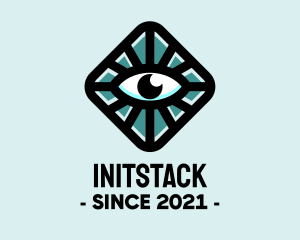

[](https://github.com/rolfwessels/init-stack/releases)
[](https://github.com/rolfwessels/init-stack/blob/main/LICENSE.txt)



# 🌐 Init Stack

Streamline your project setup with intelligent templating. Init-Stack automates the creation of new software projects by cloning GitHub repository templates and intelligently renaming files and replacing identifiers throughout the source code to match your new project's name.

Built with .NET 10 LTS.

## Installation

**macOS and Linux**

```sh
curl -fsSL https://raw.githubusercontent.com/rolfwessels/init-stack/main/scripts/install.sh | sh
```

The installer uses `curl` and `unzip` and installs to `~/.local/bin`. If that directory is missing from your PATH, add this to your shell profile:

```sh
export PATH="$HOME/.local/bin:$PATH"
```

**Windows (PowerShell)**

```powershell
irm https://raw.githubusercontent.com/rolfwessels/init-stack/main/scripts/install.ps1 | iex
```

The installer uses `%LOCALAPPDATA%\Programs\init-stack` and adds it to your user PATH.

Both installers select an x64 or ARM64 build, verify its SHA-256 checksum, and install the latest release. Rerun the same command to upgrade. Set `INSTALL_DIR` in your shell before running the installer to use a different directory.

The binaries include the .NET runtime. Linux builds target glibc-based distributions. Install Git to use GitHub templates and create the default initial commit. For a manual install, extract the ZIP for your OS and architecture from the [latest release](https://github.com/rolfwessels/init-stack/releases/latest) and put the executable on your PATH.

## 🔍 Using the CLI

### Quick Start

Create a new project from a template:

```bash
init-stack new
```

### Using a Local Template

Use a local folder as a template:

```bash
init-stack new ./templates/MyProjectName
```

### Specify Output Name and Location

```bash
init-stack new ./templates/MyProjectName MyNewName -o ./projects
```

### Using Template Names

If you know the template name:

```bash
init-stack new template-dotnet-core-console-app NewConsoleApp -o .
```

### Available Templates

The default template collection includes:

- [template-dotnet-core-console-app](https://github.com/rolfwessels/template-dotnet-core-console-app) — .NET console application
- [template-dotnet-core-graphql-app](https://github.com/rolfwessels/template-dotnet-core-graphql-app) — .NET GraphQL application
- [template-go-agent](https://github.com/rolfwessels/template-go-agent) — Go AI agent
- [template-go-console-app](https://github.com/rolfwessels/template-go-console-app) — Go console application
- [template-react-spa-site](https://github.com/rolfwessels/template-react-spa-site) — React single-page application

### Custom Git Configuration

The new project initializes with git and creates an initial commit. Override the git user and email:

```bash
init-stack new template-dotnet-core-console-app NewConsoleApp -o . --git-name "Your Name" --git-email "your.email@example.com"
```


## 🚀 Getting Started as a Developer

This project includes a development container with all required tooling for building, publishing, and deploying.

### Quick Setup

```bash
# Bring up the development environment
make build up

# Test the project
make test

# Run the application
make start

# Build and package release binaries locally
make package
```

### Docker Deployment

```bash
# Build, login, and push Docker images
make docker-publish

# Tag a specific environment release
make docker-pull-short-tag docker-tag-env env=latest

# Deploy to an environment
make deploy env=dev
```
## 🛠 Prerequisites

- **Docker**: Required for containerized development. [Installation guide](https://docs.docker.com/get-docker/)
- **Git**: For version control. [Download Git](https://git-scm.com/downloads)
- **Make**: Command runner (available via WSL on Windows)
- **.NET 10 SDK**: For local development outside containers

## 📋 Available Make Commands

### 💻 Local Machine Commands

- `make up`: Start the container and attach to the default shell
- `make down`: Stop the container
- `make build`: Rebuild the container

### 🐳 Container Commands

- `make version`: Display current version number
- `make start`: Run Init Stack
- `make test`: Run tests with coverage
- `make publish`: Build self-contained executables for all six release targets
- `make package`: Build ZIPs and SHA-256 checksums in `dist/release`. Use `make package RIDS=linux-x64` to build one target.
- `make docker-login`: Authenticate with Docker registry
- `make docker-build`: Build Docker image
- `make docker-push`: Push Docker image to registry
- `make docker-pull-short-tag`: Pull image by git hash
- `make docker-tag-env`: Tag image for specific environment
- `make docker-publish`: Complete Docker build and publish workflow
- `make deploy`: Deploy to specified environment
- `make update-packages`: Update NuGet packages to latest versions

## 💻 Development

### Adding a New Project

```bash
# Create a new class library
dotnet new classlib -n InitStack.Core -o ./src/InitStack.Core

# Create corresponding test project
dotnet new nunit -n InitStack.Core.Tests -o ./tests/InitStack.Core.Tests

# Add to solution
dotnet sln InitStack.sln add ./src/InitStack.Core/InitStack.Core.csproj
dotnet sln InitStack.sln add ./tests/InitStack.Core.Tests/InitStack.Core.Tests.csproj

# Verify
dotnet sln InitStack.sln list
```

### 🔄 Versioning

This project follows [Semantic Versioning (SemVer)](https://semver.org/):

- **MAJOR**: Incompatible API changes
- **MINOR**: Backward-compatible functionality additions
- **PATCH**: Backward-compatible bug fixes

**Version Management:**

- `MAJOR` and `MINOR` versions are set manually via the `versionPrefix` variable in the Makefile
- `PATCH` levels are automatically determined from commit count on the `main` branch
- Feature branches include pre-release identifiers based on commit delta from `main`

**Check Current Version:**

```bash
make version
```

## 🔄 Development Workflow

This project uses a modified [Git Flow](https://nvie.com/posts/a-successful-git-branching-model/) workflow optimized for continuous delivery.

### Branching Strategy

**Feature/Bug Branches**

- Create from `main` branch
- Naming: `feature/description` or `bug/description`
- Examples: `feature/add-login`, `bug/fix-login-button`

**Main Branch**

- Production-ready code
- Feature branches merge here when complete
- GitHub Actions publishes a new versioned release after all six packages pass their smoke tests

**Releases**

- PRs produce downloadable ZIPs in their GitHub Actions run
- After merging to `main`, CI publishes the tested archives and checksums and creates the version tag
- If a release job fails, rerun the failed job from GitHub Actions

**Hotfixes**

- Merge the fix to `main` to publish the next version

## ❓ FAQ

**Q: Is this application cross-platform?**

A: Yes, Init Stack runs on Linux, macOS, and Windows.

**Q: How do I update to the latest version?**

A: Rerun your platform's [install command](#installation).

**Q: What templates are available?**

A: See [Available Templates](#available-templates) for the default collection. You can also use any GitHub repository as a template, or create your own local templates.

## 📚 Resources

- [What is a Makefile?](https://opensource.com/article/18/8/what-how-makefile)
- [Git Flow Workflow](https://nvie.com/posts/a-successful-git-branching-model/)
- [Semantic Versioning](https://semver.org/)

## 📄 License

This project is licensed under the terms specified in [LICENSE.txt](LICENSE.txt).
